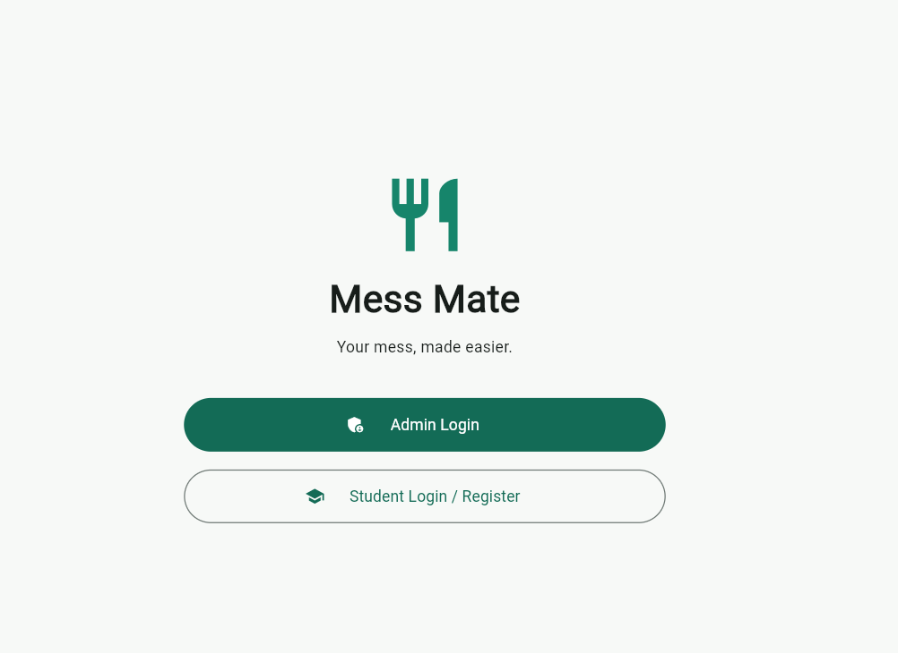
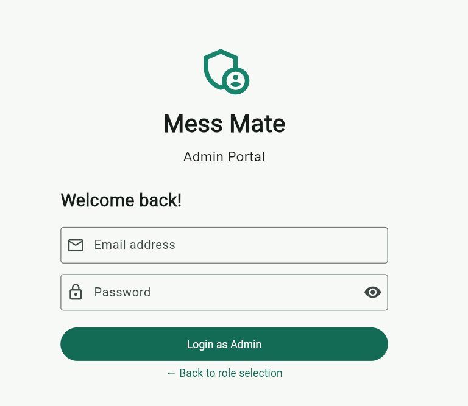
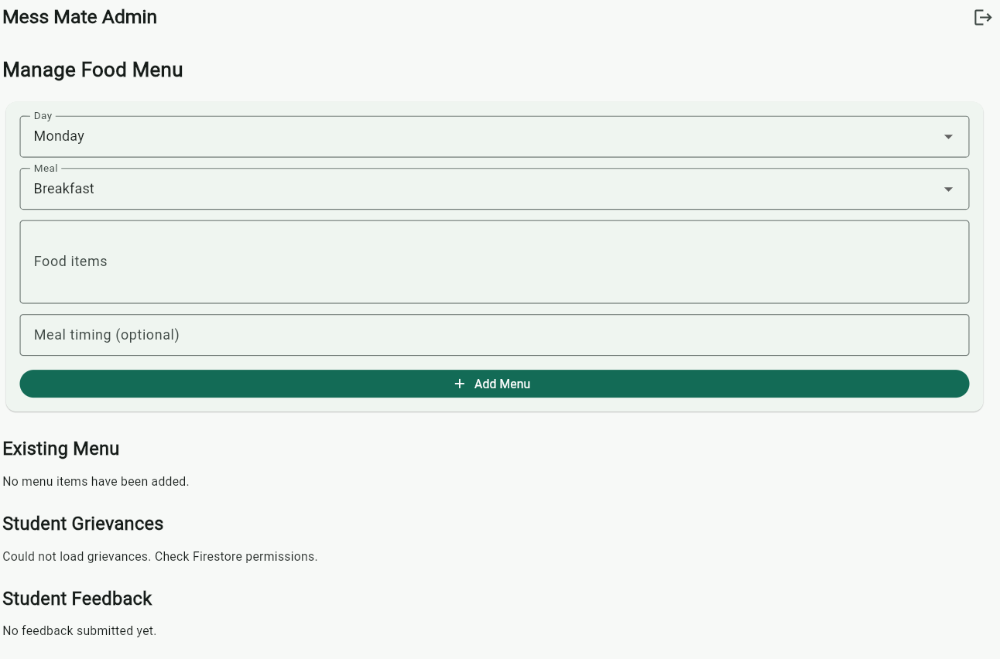
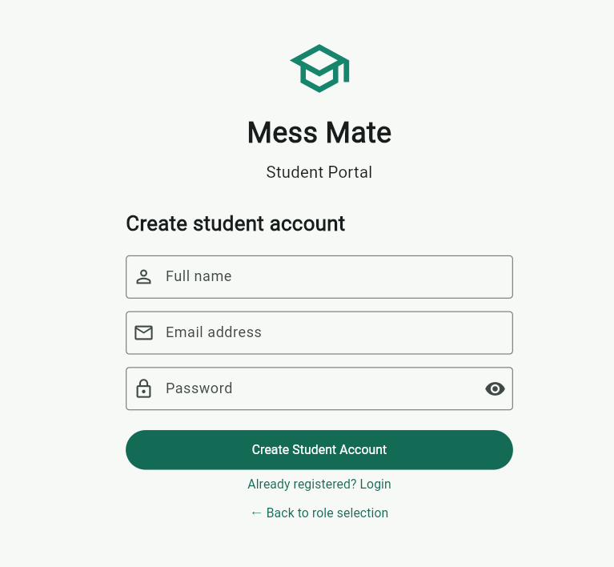
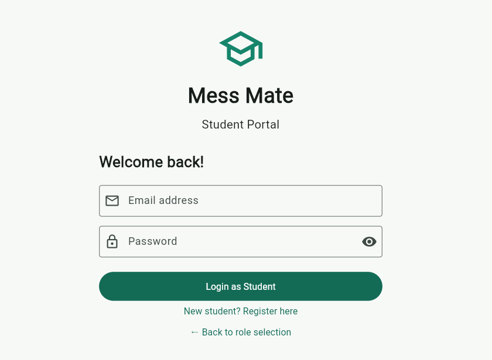
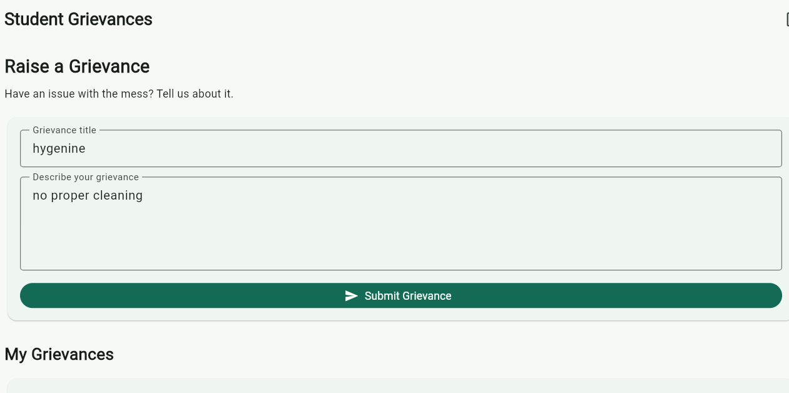
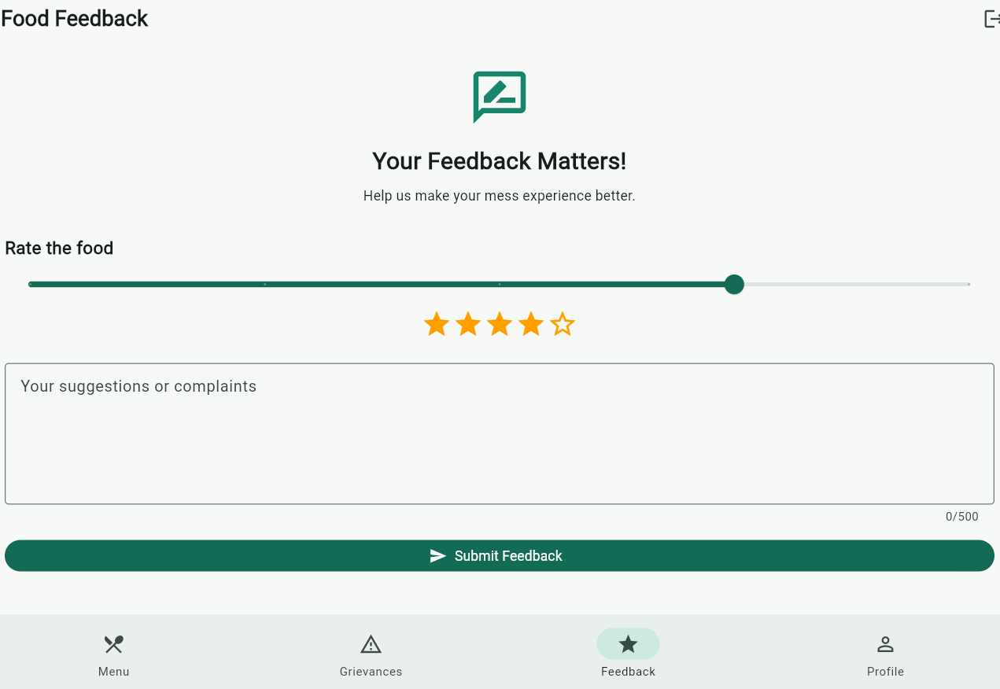
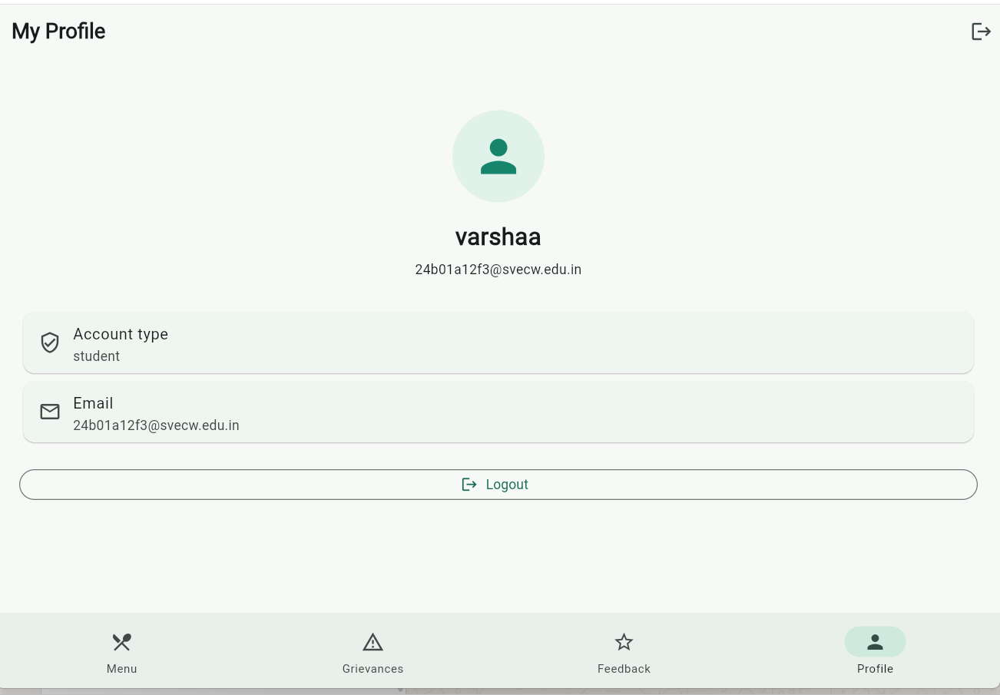

# MSESS Mate

**A Student-Centric Campus Services and Grievance Management Application**

MSESS Mate is a Flutter-based mobile application designed to simplify access to campus services and improve communication between students and administrators. It integrates Firebase Authentication and Cloud Firestore to support authentication, student profiles, mess menu information, feedback submission, and grievance management.

The application aims to provide a centralized and convenient platform for students to access campus information and communicate their concerns.

---

## 📑 Table of Contents

- [Overview](#-overview)
- [Objectives](#-objectives)
- [Features](#-features)
- [App Screenshots](#-app-screenshots)
- [Technology Stack](#-technology-stack)
- [Application Architecture](#-application-architecture)
- [Project Structure](#-project-structure)
- [Firebase Integration](#-firebase-integration)
- [Firestore Data Model](#-firestore-data-model)
- [Security and Access Control](#-security-and-access-control)
- [Prerequisites](#-prerequisites)
- [Installation and Setup](#-installation-and-setup)
- [Running the Application](#-running-the-application)
- [Testing and Troubleshooting](#-testing-and-troubleshooting)
- [Future Enhancements](#-future-enhancements)
- [Contributing](#-contributing)
- [License](#-license)

---

## 📌 Overview

Campus-related information and student concerns can become difficult to manage when services are spread across multiple channels. MSESS Mate aims to bring essential campus services together in a single mobile application.

The application uses Flutter for its cross-platform user interface and Firebase for authentication and cloud-based data management. Firestore security rules control access to data based on the authenticated user's identity and role.

The application supports two primary roles:

- **Students:** Access available campus information, view the mess menu, manage permitted profile details, submit feedback, and raise grievances.
- **Administrators:** Access authorized administrative functions, manage menu information, and review feedback or other permitted data.

The availability of individual functions depends on the implemented screens and configured Firebase permissions.

## 🎯 Objectives

- Provide a convenient mobile interface for campus-related services.
- Simplify the submission of student grievances.
- Improve communication between students and administrators.
- Organize application data using Cloud Firestore.
- Authenticate users and restrict unauthorized data access.
- Maintain a modular and maintainable Flutter codebase.

## ✨ Features

### 1. Authentication and Authorization

Firebase Authentication establishes the identity of application users.

- Student registration and login.
- Authentication-state monitoring.
- Access to protected application screens.
- Role-based authorization through Firestore security rules.

### 2. Student Profile

- View student profile information.
- Access information associated with the authenticated account.
- Update permitted profile fields.
- Maintain student role information.

### 3. Mess Menu

- View mess menu information.
- Retrieve menu data from Cloud Firestore.
- Restrict menu management operations to authorized administrators.

### 4. Grievance Management

The grievance module enables students to submit campus-related concerns through the application.

**Grievance workflow:**

1. The student signs in.
2. The student opens the grievance section.
3. The student enters the required grievance details.
4. The application associates the submission with the authenticated user's UID.
5. Firestore security rules validate the request.
6. The grievance is saved if the operation is authorized.

Grievance data should be protected so that students cannot access other students' private submissions.

### 5. Feedback System

- Submit feedback and ratings.
- Validate feedback fields through Firestore security rules.
- Restrict feedback review and management to authorized administrators.

The configured rules validate the authenticated user's UID, email, rating, message, and required fields.

### 6. Role-Based Access Control

- Students have restricted access to their own profile and permitted records.
- Administrators can perform authorized administrative operations.
- Database permissions are enforced through Firestore rules, not just through UI visibility.

Administrator roles should be assigned using a trusted process.

---


## 📷 App Screenshots

Here is a visual overview of the MSESS Mate application, including authentication, student services, and administrator screens.

| Home Page | Admin Login | Admin Screen |
|:---:|:---:|:---:|
|  |  |  |
| **Student Registration** | **Student Login** | **Mess Menu** |
|  |  |  |
| **Grievances** | **Feedback** | **Student Profile** |
|  |  |  |


> **Note:** Keep the screenshot files in `lib/screenshots/` with the exact filenames shown above. GitHub resolves these relative image paths from the repository root. The screenshots will appear only after the image files are committed and pushed to the repository.

---

## 🛠️ Technology Stack

| Technology | Purpose |
|---|---|
| Flutter | Cross-platform mobile application development |
| Dart | Application programming language |
| Firebase Authentication | User authentication |
| Cloud Firestore | Cloud-hosted NoSQL database |
| Riverpod | State management and dependency management |
| Visual Studio Code | Development and debugging |

The exact package dependencies and versions are defined in `pubspec.yaml`.

## 🏗️ Application Architecture

MSESS Mate uses a Flutter-based architecture integrated with Firebase services.

### Presentation Layer
- Application screens and reusable widgets.
- User input and form validation.
- Loading, success, and error states.

### State Management Layer
- Riverpod providers.
- Authentication-state monitoring.
- Shared application state.

### Service Layer
- Authentication operations.
- Firestore reads and writes.
- Application-specific data handling.

### Backend Services
- Firebase Authentication for identity verification.
- Cloud Firestore for persistent data storage.
- Firestore Security Rules for access control.

This separation supports maintainability, readability, and testability.

## 📂 Project Structure

```text
mess_mate/
├── android/
├── ios/
├── web/
├── windows/
├── macos/
├── linux/
├── lib/
│   ├── models/
│   │   └── meal.dart                 # Data models for meals and menu items
│   ├── screens/
│   │   ├── admin_screen.dart         # Admin dashboard and management portal
│   │   ├── feedback_screen.dart      # Student feedback collection screen
│   │   ├── grievance_screen.dart     # Grievance registration and tracking screen
│   │   ├── home_screen.dart          # Student home dashboard
│   │   ├── login_screen.dart         # Role-based login and registration
│   │   ├── menu_screen.dart          # Mess menu display screen
│   │   └── profile_screen.dart       # User profile details
│   ├── screenshots/                  # App screenshots for documentation
│   ├── services/
│   │   ├── auth_service.dart         # Firebase Authentication logic
│   │   └── mess_service.dart         # Firestore database operations
│   ├── widgets/
│   │   └── meal_card.dart            # Custom reusable card widget for meals
│   ├── firebase_options.dart         # Generated Firebase configuration
│   └── main.dart                     # App entry point & Riverpod auth wrapper
├── test/
│   └── widget_test.dart
├── .gitignore
├── pubspec.yaml
└── README.md
```

### Important Files

- `lib/main.dart` — Application entry point.
- `lib/providers/` — Riverpod providers and state management, if organized this way.
- `lib/services/` — Authentication and database service logic, if present.
- `lib/screens/` — Application screens.
- `lib/widgets/` — Reusable UI components.
- `lib/models/` — Data models, if used.
- `lib/screenshots/` — Screenshots referenced in this README.
- `pubspec.yaml` — Project metadata and dependencies.

## 🔥 Firebase Integration

MSESS Mate uses Firebase for authentication and cloud data storage.

### Firebase Authentication

Authentication establishes the identity of the current user. Firestore security rules use the authenticated UID to authorize database operations.

### Cloud Firestore

Firestore stores application data in collections and documents. Collection paths and field names in the Flutter code must match the database structure and security rules.

### Firebase Setup

1. Open the [Firebase Console](https://console.firebase.google.com/).
2. Select the Firebase project associated with the application.
3. Register the appropriate Android or iOS application.
4. Configure Firebase using the official [FlutterFire setup guide](https://firebase.google.com/docs/flutter/setup).
5. Verify Firebase configuration files and generated options.
6. Enable the required Authentication provider.
7. Create or select a Cloud Firestore database.
8. Publish and test the appropriate security rules.

Official documentation:

- [FlutterFire Setup](https://firebase.google.com/docs/flutter/setup)
- [Firebase Authentication](https://firebase.google.com/docs/auth)
- [Cloud Firestore](https://firebase.google.com/docs/firestore)

## 🗄️ Firestore Data Model

The configured security rules define the following top-level collections.

| Collection | Purpose | Access Model |
|---|---|---|
| `users` | Student profiles and role information | Users can read their own profiles; administrators can read profiles |
| `menus` | Mess menu information | Signed-in users can read; administrators can manage |
| `feedback` | Feedback messages and ratings | Authenticated users can create validated feedback; administrators can review |
| `grievances` | Student grievance submissions | Intended for owner-restricted access and authorized administration |

### User Documents

Expected path:

`users/{userId}`

The document ID should correspond to the authenticated user's UID.

The configured rules require new student profiles to use the `student` role and an email matching the authenticated user's email. Regular users may update only their `name` field under the current rules.

### Feedback Documents

Expected fields:

- `uid`
- `email`
- `rating`
- `message`
- `createdAt`

Values must satisfy the published Firestore validation rules.

### Grievance Documents

Expected path:

`grievances/{grievanceId}`

Each grievance should include a `uid` field identifying its owner. The Flutter submission code and Firestore rules must use the same collection path and field names.

Additional validation should cover required fields, content length, and permitted status values.

## 🔐 Security and Access Control

Security is enforced through Firebase Authentication and Cloud Firestore Security Rules.

Important practices:

- Require authentication for protected operations.
- Verify ownership before allowing access to private student records.
- Restrict administrative operations to authorized administrators.
- Validate submitted data in Firestore rules.
- Avoid unrestricted database access.
- Never commit service-account private keys or passwords.
- Keep sensitive local configuration and private data out of version control.
- Test permissions with different user roles before deployment.

Client-side checks alone do not secure database operations. Firestore rules must independently enforce authorization.

## ⚙️ Prerequisites

Install the following tools:

- Flutter SDK.
- Dart SDK compatible with the installed Flutter version.
- Android Studio or Visual Studio Code.
- Flutter and Dart editor extensions.
- An Android emulator or compatible physical device.
- Access to the Firebase project used by the application.

Verify the development environment:

```bash
flutter --version
dart --version
flutter doctor
```

## 🚀 Installation and Setup

### 1. Install Dependencies

Open the project directory in VS Code and run:

```bash
flutter pub get
```

### 2. Configure Firebase

Follow the Firebase setup instructions above and ensure the application is connected to the correct Firebase project.

### 3. Verify Dependencies

Review `pubspec.yaml` to confirm the required Flutter, Firebase, and Riverpod packages are installed.

### 4. Analyze the Project

Run:

```bash
flutter analyze
```

Resolve any reported errors before testing the application.

## ▶️ Running the Application

Connect an emulator or physical device and run:

```bash
flutter devices
flutter run
```

To create a debug APK:

```bash
flutter build apk --debug
```

For a release build, verify production Firebase settings, app signing, and security requirements:

```bash
flutter build apk --release
```

A successful build does not replace functional or security testing.

## 🧪 Testing and Troubleshooting

### Firestore Permission Denied

**Possible cause:** The requested read or write operation is not permitted by the current Firestore rules.

Check:

- Whether the user is signed in.
- Whether the correct collection and document paths are used.
- Whether the document contains the expected UID field.
- Whether the user has the correct role.
- Whether required fields and data types match the rules.
- Whether the latest rules have been published.

Do not resolve permission errors by granting unrestricted database access.

### Authentication Issues

Check Firebase Authentication configuration, enabled sign-in providers, and authentication state before making protected Firestore requests.

### Missing or Incorrect Data

Verify collection names, document IDs, field names, and data types. Firestore paths and field names must match those used by the Flutter application.

### Recommended Test Cases

- A student can access their own permitted profile.
- A student cannot access another student's private profile.
- A student cannot grant themselves administrator privileges.
- An authenticated user can submit valid feedback.
- Invalid feedback is rejected.
- A student cannot read another student's grievance.
- Unauthorized administrative operations are rejected.

## 🔮 Future Enhancements

Potential improvements include:

- Grievance status tracking.
- Administrative assignment and resolution workflows.
- Notifications for grievance updates.
- Search and filtering for authorized administrators.
- Improved input validation and error messages.
- Automated unit and integration tests.
- Accessibility improvements and UI refinements.
- Analytics with appropriate privacy safeguards.

These are proposed enhancements and are not necessarily implemented in the current version.

## 🤝 Contributing

Contributions can help improve application quality and maintainability.

1. Identify an issue or improvement.
2. Discuss substantial changes with the project maintainer.
3. Follow the existing code style and architecture.
4. Test changes before submitting them.
5. Document new features and configuration requirements.


## 🙌 Acknowledgements

Built using Flutter, Dart, Firebase Authentication, Cloud Firestore, and Riverpod.

---

**MSESS Mate — Bringing campus services and student communication together.**
